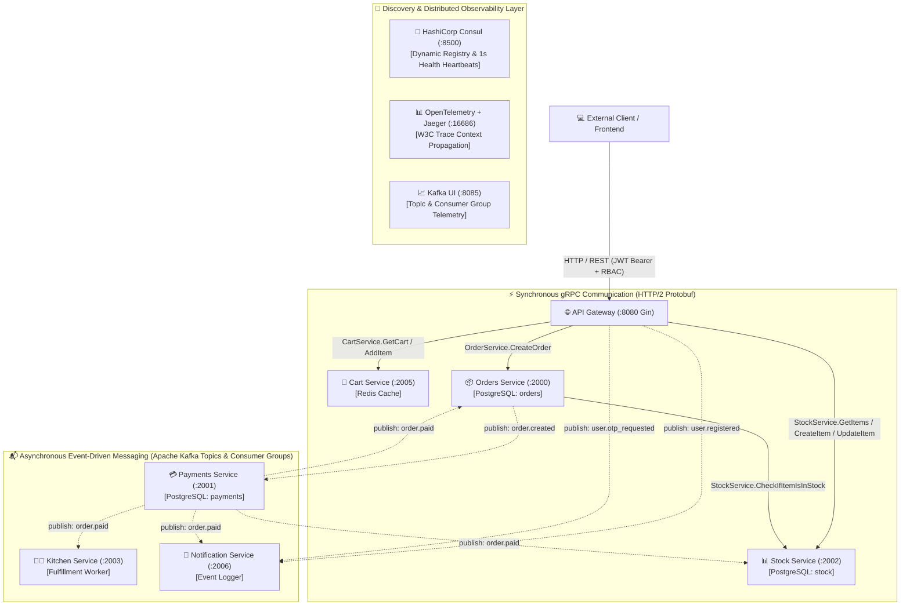
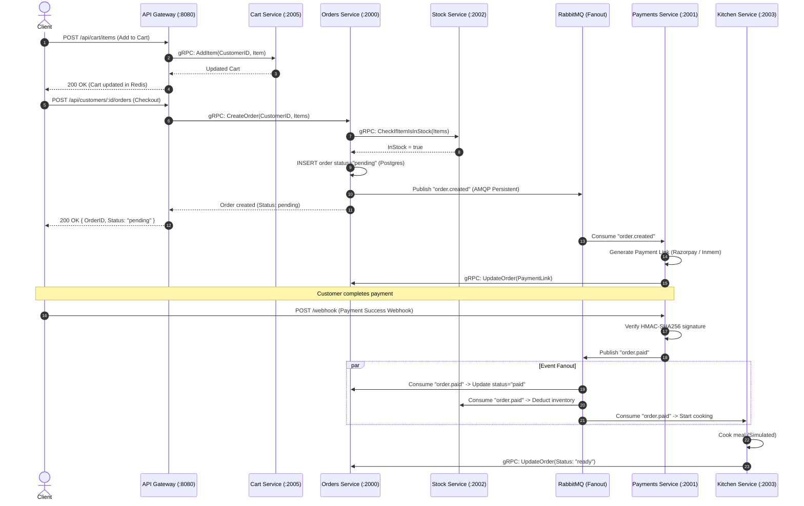

# ⚡ STRATUM — High-Performance Distributed Order Management System (Go Microservices & Kafka)

[](https://golang.org)
[](https://grpc.io)
[](https://kafka.apache.org)
[](https://www.postgresql.org)
[](https://redis.io)
[](https://www.consul.io)
[](https://opentelemetry.io)
[](https://www.docker.com)

A production-grade, event-driven Order Management System backend engineered in **Go**. The system showcases modern distributed systems design patterns: **Database-per-Service**, dual-protocol communication (**synchronous gRPC** for critical low-latency paths and **asynchronous Apache Kafka topics** for decoupled eventual consistency and event streaming), dynamic service discovery via **HashiCorp Consul**, end-to-end distributed tracing via **OpenTelemetry & Jaeger**, and granular **Role-Based Access Control (RBAC)**.

---

## 📑 Table of Contents

- [Distributed System Architecture](#-distributed-system-architecture)
- [Core Architectural Patterns & Design Decisions](#-core-architectural-patterns--design-decisions)
- [Microservices Catalog & Technical Deep Dive](#-microservices-catalog--technical-deep-dive)
  - [1. API Gateway (`gateway`)](#1-api-gateway-gateway)
  - [2. Orders Service (`orders`)](#2-orders-service-orders)
  - [3. Payments Service (`payments`)](#3-payments-service-payments)
  - [4. Stock Service (`stock`)](#4-stock-service-stock)
  - [5. Kitchen Service (`kitchen`)](#5-kitchen-service-kitchen)
  - [6. Cart Service (`cart`)](#6-cart-service-cart)
  - [7. Notification Service (`notification`)](#7-notification-service-notification)
  - [8. Shared Commons (`common`)](#8-shared-commons-common)
- [End-to-End Transaction Sequence](#-end-to-end-transaction-sequence)
- [Protobuf Contracts (`oms.proto`)](#-protobuf-contracts-omsproto)
- [API Gateway REST Specification](#-api-gateway-rest-specification)
  - [Authentication & Users](#authentication--users)
  - [Cart Operations](#cart-operations)
  - [Order Management](#order-management)
  - [Inventory Catalog](#inventory-catalog)
  - [Admin Management Endpoints (RBAC Restricted)](#admin-management-endpoints-rbac-restricted)
  - [Payments Webhook](#payments-webhook)
- [Reliability, Fault Tolerance & DLQ](#-reliability-fault-tolerance--dlq)
- [Distributed Tracing & Context Propagation](#-distributed-tracing--context-propagation)
- [Environment Configuration](#-environment-configuration)
- [Running the Backend](#-running-the-backend)
  - [Option A: Fully Containerized (Docker Compose)](#option-a-fully-containerized-docker-compose)
  - [Option B: Hybrid Development Mode](#option-b-hybrid-development-mode)
- [Administrative Bootstrap](#-administrative-bootstrap)
- [Observability & Infrastructure Consoles](#-observability--infrastructure-consoles)

---

## 🏛️ Distributed System Architecture



---

## 💡 Core Architectural Patterns & Design Decisions

### 1. Database-per-Service Pattern
- Services own their datastores strictly:
  - `gateway` ➔ PostgreSQL database `gateway` (Users, credentials, roles).
  - `orders` ➔ PostgreSQL database `orders` (Order entities, line items, status).
  - `payments` ➔ PostgreSQL database `payments` (Payment records, payment links, transaction references).
  - `stock` ➔ PostgreSQL database `stock` (Inventory items, real-time stock levels, row-level atomic locks).
  - `cart` ➔ Redis (Key-value cache with TTL).
- Direct cross-service database access is completely prohibited. State mutations across domains are coordinated via **synchronous gRPC** or **eventual consistency via AMQP events**.

### 2. Dual-Protocol Communication Architecture
- **gRPC (Protobuf)**: Used on the critical query and reservation path where low latency, compact binary serialization, and strong type safety are required (e.g., verifying stock availability prior to order insertion).
- **Apache Kafka (Event Streaming)**: Used for non-blocking event publishing across topics (`order.created`, `order.paid`, `user.registered`, `user.otp_requested`, and Saga rollback topics) consumed by partitioned Consumer Groups with automatic offset commits and DLQ retries.

### 3. Dynamic Service Discovery & Health Checking
- All Go microservices register themselves dynamically with **HashiCorp Consul** upon startup using a generated instance ID (`service-name-<uuid>`).
- Services maintain a continuous **1-second TTL health check heartbeat**. If a service experiences failure, Consul automatically evicts the node after 10 seconds.
- Client-side discovery resolves upstream addresses dynamically without hardcoded service IPs.

### 4. Distributed Tracing Across Protocol Boundaries
- Integrated with **OpenTelemetry Go SDK** exporting to **Jaeger** over OTLP HTTP (`:4318`).
- Trace context is continuously propagated:
  - From incoming HTTP requests to internal spans.
  - Across gRPC unary calls via gRPC metadata.
  - Across RabbitMQ message headers using custom injection (`broker.InjectAMQPHeaders`) and extraction (`broker.ExtractAMQPHeader`).

### 5. Role-Based Access Control (RBAC) & Token Rotation
- Custom JWT claims structure (`CustomClaims`) containing `customer_id`, `role` (`customer` or `admin`), and `token_type` (`access` or `refresh`).
- Token lifetimes:
  - **Access Token**: Short-lived (10 minutes) for minimizing attack surface.
  - **Refresh Token**: Long-lived (10 days) for seamless token renewal via `/api/users/refresh`.
- Gin route groups are protected by tiered middlewares: `authMiddleware()` ensures valid authentication; `adminAuthMiddleware()` enforces the `admin` role.

### 6. Dual-Engine Payment Processor
- **Razorpay Integration**: Creates live payment links and processes webhook callbacks with HMAC-SHA256 signature verification and idempotency safeguards.
- **In-Memory Fallback**: When Razorpay credentials are left empty or set to `dummy_key`, the service seamlessly switches to an internal in-memory payment engine—enabling full end-to-end local testing without external third-party dependencies.

### 7. Choreography-Based Saga Pattern & Distributed Rollback
- Multi-step order transactions implement an **Event-Driven Choreography Saga**:
  - **Forward Path**:
    1. `orders` creates order (`pending`) and broadcasts `order.created`.
    2. `payments` consumes `order.created`, generates payment session, and updates order.
    3. Upon payment verification, `payments` broadcasts `order.paid`.
    4. `stock` decrements inventory, `kitchen` begins preparation (`ready`), and `orders` marks status as `paid`.
  - **Compensating Rollback Workflows**:
    - **Stock Failure on Payment**: If stock decrement fails when `order.paid` is received, `stock` broadcasts `order.stock_failed` and `order.failed`. In response, `payments` triggers a refund (`order.refunded`) and `orders` marks the status as `cancelled`.
    - **Customer or Admin Cancellation**: When an order is cancelled via `/api/customers/:customerID/orders/:orderID/cancel` or `/api/admin/orders/:orderID/cancel`, `gateway` publishes `order.cancelled`. All participating services execute compensating actions:
      - `stock`: Calls `IncrementItems` to restore reserved quantities back to warehouse inventory.
      - `payments`: Calls `RefundPayment` to issue customer refund and emits `order.refunded`.
      - `kitchen`: Immediately aborts meal preparation.
      - `orders`: Permanently transitions order state to `cancelled` or `refunded`.

---

## 📦 Microservices Catalog & Technical Deep Dive

### 1. API Gateway (`gateway`)
- **Transport / Port**: HTTP REST (`:8080`) via Gin framework.
- **Datastore**: PostgreSQL (`gateway` database).
- **Key Responsibilities**:
  - Serves as the single edge entry point for external traffic.
  - Handles customer registration, password hashing, and JWT token issuance.
  - Manages client-side gRPC connection pools to `orders`, `cart`, and `stock` services via Consul discovery.
  - Enforces rate limiting (Token Bucket) and RBAC policies (`adminAuthMiddleware`).
  - Translates gRPC status codes (`codes.InvalidArgument`, `codes.NotFound`, `codes.FailedPrecondition`) to HTTP status codes.
- **AMQP Producer**: Publishes `user.registered` upon successful user signup.

### 2. Orders Service (`orders`)
- **Transport / Port**: gRPC (`:2000`) implementing `api.OrderServiceServer`.
- **Datastore**: PostgreSQL (`orders` database).
- **Key Responsibilities**:
  - Validates and places customer orders (`CreateOrder`).
  - Coordinates synchronous stock verification with `StockService` via gRPC before persisting the order.
  - Manages order lifecycle transitions: `pending` ➔ `paid` ➔ `ready`.
  - Publishes `order.created` event with OpenTelemetry tracing headers injected into RabbitMQ.
  - Subscribes to `order.paid` to transition orders to `paid` status.

### 3. Payments Service (`payments`)
- **Transport / Port**: gRPC (`:2001`) + HTTP Webhook server (`:8081` / `:2001`).
- **Datastore**: PostgreSQL (`payments` database).
- **Key Responsibilities**:
  - Subscribes to `order.created` events from RabbitMQ.
  - Invokes payment gateway processor (Razorpay API or In-Memory fallback) to generate checkout links.
  - Updates the order record with the generated payment link via gRPC back to `OrdersService`.
  - Handles payment webhook callbacks, verifying the `X-Razorpay-Signature` using HMAC-SHA256.
  - Publishes `order.paid` event upon confirmed payment capture.

### 4. Stock Service (`stock`)
- **Transport / Port**: gRPC (`:2002`) implementing `api.StockServiceServer`.
- **Datastore**: PostgreSQL (`stock` database on port 5436) with automatic fallback to thread-safe In-Memory Store.
- **Key Responsibilities**:
  - Responds to `CheckIfItemIsInStock` queries on the synchronous order checkout path.
  - Provides catalog item details (`GetItems`).
  - Supports administrative product addition (`CreateItem`) and stock replenishment (`UpdateItem`).
  - Subscribes to `order.paid` events via RabbitMQ and atomically deducts inventory counts via row-level SQL transactions.

### 5. Kitchen Service (`kitchen`)
- **Transport / Port**: gRPC (`:2003`) + AMQP Consumer.
- **Datastore**: Stateless.
- **Key Responsibilities**:
  - Subscribes to `order.paid` events.
  - Simulates meal preparation routines with asynchronous worker channels.
  - Calls `OrderService.UpdateOrder` via gRPC to update the order status to `ready` once preparation finishes.

### 6. Cart Service (`cart`)
- **Transport / Port**: gRPC (`:2005`) implementing `api.CartServiceServer`.
- **Datastore**: Redis (`:6379`).
- **Key Responsibilities**:
  - Manages shopping cart state per customer ID.
  - Implements `AddItem`, `RemoveItem`, `GetCart`, and `ClearCart`.
  - Leverages Redis hash operations for fast item mutations and key expiry.

### 7. Notification Service (`notification`)
- **Transport / Port**: AMQP Consumer (`:2006`).
- **Datastore**: Stateless.
- **Key Responsibilities**:
  - Subscribes to `user.registered` and `order.paid` events.
  - Extracts OpenTelemetry span context from message headers and logs/notifies external channels.

### 8. Shared Commons (`common`)
- **Module**: `github.com/jaydeepjr28/commons`
- **Sub-packages**:
  - `common/api`: Compiled Protocol Buffer stubs (`oms.pb.go`, `oms_grpc.pb.go`) and definition (`oms.proto`).
  - `common/auth`: JWT signing, validation, claims definition, and role verification.
  - `common/broker`: RabbitMQ connection setup, exchange declarations, DLX/DLQ management, retry backoff, and tracing header injection/extraction.
  - `common/discovery`: HashiCorp Consul registration, deregistration, TTL health checking, and service discovery resolver.
  - `common/tracer.go`: OpenTelemetry OTLP trace provider setup with Jaeger.

---

## 🔁 End-to-End Transaction Sequence



---

## 📜 Protobuf Contracts (`oms.proto`)

Located at `common/api/oms.proto`:

```protobuf
syntax = "proto3";

package api;
option go_package = "github.com/jaydeepjr28/commons/api";

message Order {
  string ID = 1;
  string customerID = 2;
  string Status = 3;
  repeated Item Items = 4;
  string PaymentLink = 5;
}

message Item {
  string ID = 1;
  string Name = 2;
  int32 Quantity = 3;
  string PriceID = 4;
}

message ItemsWithQuantity {
  string ID = 1;
  int32 Quantity = 2;
}

service OrderService {
  rpc CreateOrder(CreateOrderRequest) returns (Order);
  rpc GetOrder(GetOrderRequest) returns (Order);
  rpc GetCustomerOrders(GetCustomerOrdersRequest) returns (GetCustomerOrdersResponse);
  rpc UpdateOrder(Order) returns (Order);
}

service StockService {
  rpc CheckIfItemIsInStock(CheckIfItemIsInStockRequest) returns (CheckIfItemIsInStockResponse);
  rpc GetItems(GetItemsRequest) returns (GetItemsResponse);
  rpc CreateItem(CreateItemRequest) returns (Item);
  rpc UpdateItem(UpdateItemRequest) returns (Item);
}

service CartService {
  rpc AddItem(AddItemRequest) returns (Cart);
  rpc RemoveItem(RemoveItemRequest) returns (Cart);
  rpc GetCart(GetCartRequest) returns (Cart);
  rpc ClearCart(ClearCartRequest) returns (Cart);
}

service UserService {
  rpc Register(RegisterRequest) returns (AuthResponse);
  rpc Login(LoginRequest) returns (AuthResponse);
  rpc GetUser(GetUserRequest) returns (User);
}
```

---

## 📡 API Gateway REST Specification

Base URL: `http://localhost:8080`

### Authentication & Users

#### 1. Request Registration Verification Code (OTP)
`POST /api/users/register/send-otp`
```json
{
  "name": "Alex Mercer",
  "email": "customer@example.com",
  "password": "securepassword123"
}
```
**Response (200 OK):**
```json
{
  "message": "Verification code sent to your email",
  "email": "customer@example.com",
  "expiresInSeconds": 300,
  "cooldownSeconds": 60
}
```

#### 2. Verify OTP & Finalize Registration
`POST /api/users/register/verify-otp`
```json
{
  "email": "customer@example.com",
  "otp": "492810"
}
```
**Response (201 Created):**
```json
{
  "accessToken": "eyJhbGciOiJIUzI1NiIs...",
  "refreshToken": "eyJhbGciOiJIUzI1NiIs...",
  "customerID": "customer@example.com",
  "role": "customer",
  "name": "Alex Mercer"
}
```

#### 3. Resend Registration Code
`POST /api/users/register/resend-otp`
```json
{
  "email": "customer@example.com"
}
```

#### 4. Direct User Registration (Legacy / Automated)
`POST /api/users/register`
```json
{
  "email": "customer@example.com",
  "password": "securepassword123",
  "name": "Alex Mercer"
}
```
**Response (200 OK):**
```json
{
  "AccessToken": "eyJhbGciOiJIUzI1NiIs...",
  "RefreshToken": "eyJhbGciOiJIUzI1NiIs...",
  "CustomerID": "customer@example.com"
}
```

#### 2. User Login
`POST /api/users/login`
```json
{
  "email": "customer@example.com",
  "password": "securepassword123"
}
```
**Response (200 OK):** Returns new `AccessToken` and `RefreshToken`.

#### 3. Refresh Access Token
`POST /api/users/refresh`
```json
{
  "refreshToken": "eyJhbGciOiJIUzI1NiIs..."
}
```
**Response (200 OK):** Returns fresh `AccessToken` and rotated `RefreshToken`.

---

### Cart Operations
*Requires `Authorization: Bearer <AccessToken>`*

- `GET /api/cart` — Fetch customer's active cart.
- `POST /api/cart/items` — Add an item to cart:
  ```json
  {
    "productID": "1",
    "quantity": 2
  }
  ```
- `DELETE /api/cart/items/:productID` — Remove a specific product from cart.
- `DELETE /api/cart` — Clear the entire cart.

---

### Order Management
*Requires `Authorization: Bearer <AccessToken>`*

- `POST /api/customers/:customerID/orders` — Checkout order:
  ```json
  [
    { "ID": "1", "Quantity": 2 },
    { "ID": "2", "Quantity": 1 }
  ]
  ```
  **Response (200 OK):**
  ```json
  {
    "ID": "66df2e8f1a2b3c4d",
    "customerID": "customer@example.com",
    "Status": "pending",
    "Items": [
      { "ID": "1", "Name": "Burger", "Quantity": 2, "PriceID": "price_1" }
    ],
    "PaymentLink": ""
  }
  ```
- `GET /api/customers/:customerID/orders` — List all orders for the authenticated customer.
- `GET /api/customers/:customerID/orders/:orderID` — Fetch detailed order data.
- `GET /api/customers/:customerID/orders/:orderID/status` — Fetch current status (`pending`, `paid`, `ready`).

---

### Inventory Catalog
*Requires `Authorization: Bearer <AccessToken>`*

- `GET /api/inventory` — Lists available catalog products and live stock availability.

---

### Admin Management Endpoints (RBAC Restricted)
*Requires `Authorization: Bearer <AccessToken>` where JWT contains claim `"role": "admin"`*

#### 1. Add / Provision New Product Item
`POST /api/admin/inventory`
```json
{
  "ID": "3",
  "Name": "Crispy Fries",
  "Quantity": 50,
  "PriceID": "price_1PBaC2RoHcnwnsLnYLWpx1CK"
}
```
**Response (201 Created):**
```json
{
  "ID": "3",
  "Name": "Crispy Fries",
  "Quantity": 50,
  "PriceID": "price_1PBaC2RoHcnwnsLnYLWpx1CK"
}
```

#### 2. Update Product Item / Replenish Stock
`PUT /api/admin/inventory/:id`
```json
{
  "Name": "Crispy Fries XL",
  "Quantity": 100,
  "PriceID": "price_1PBaC2RoHcnwnsLnYLWpx1CK"
}
```
**Response (200 OK):**
```json
{
  "ID": "3",
  "Name": "Crispy Fries XL",
  "Quantity": 100,
  "PriceID": "price_1PBaC2RoHcnwnsLnYLWpx1CK"
}
```

#### 3. View System-wide Orders
`GET /api/admin/orders`

#### 4. Fetch Aggregated Metrics
`GET /api/admin/analytics`

---

### Payments Webhook
*Payments Service exposed at port `:2001` / `:8081`*

- `POST /webhook` — Invoked by Razorpay after customer checkout:
  - Headers: `X-Razorpay-Signature: <hmac_sha256_hash>`
  - Body: Razorpay payment payload. Validates signature and publishes `order.paid` event.

---

## 🛡️ Reliability, Fault Tolerance & DLQ

The messaging layer (`common/broker/kafka.go`) includes enterprise-grade resilience features:

```
[Service Error / Message Processing Failure]
            │
            ▼
    [HandleKafkaRetry()] ─── x-retry-count < 3? ──► [Backoff: 1s, 2s, 3s] ──► [Re-publish to Topic]
            │
            └─── x-retry-count >= 3?
                    │
                    ▼
            [Route to Dead Letter Topic: "dlq.main"] (Persistent)
```

1. **Dead Letter Topic (DLQ)**: If a message repeatedly fails unmarshaling or business execution, it is routed to the `dlq.main` topic for post-mortem analysis.
2. **Exponential Backoff**: Transient failures are automatically retried up to `MaxRetryCount = 3` with incremental sleep delays before DLQ routing.
3. **Partitioned Consumer Groups**: Microservices consume events via consumer groups (`orders-service-group`, `stock-service-group`, `kitchen-service-group`, `payments-service-group`, `notification-service-group`), guaranteeing ordered partition processing and horizontal scalability.

---

## 🔭 Distributed Tracing & Context Propagation

Every incoming request is tagged with a trace context and propagated across service boundaries:

```
HTTP Request (Client)
   │ (W3C Traceparent Header)
   ▼
[API Gateway] ──(gRPC Metadata Context)──► [Orders Service]
                                                  │
                                                  ▼ (broker.InjectAMQPHeaders)
                                            [RabbitMQ Header: "traceparent"]
                                                  │
                                                  ▼ (broker.ExtractAMQPHeader)
                                            [Payments / Stock / Kitchen]
```

- Spans are collected asynchronously by the **Jaeger OTLP HTTP receiver** at `http://localhost:4318/v1/traces`.
- Visual inspection of end-to-end waterfall charts is available at `http://localhost:16686`.

---

## ⚙️ Environment Configuration

Define a `.env` file in the project root:

```env
# JWT Secret Key for token signing and validation
JWT_SECRET_KEY=my-super-secret-key-1234

# PostgreSQL Database Passwords (Local)
GATEWAY_POSTGRES_PASSWORD=password
ORDERS_POSTGRES_PASSWORD=password
PAYMENTS_POSTGRES_PASSWORD=password
STOCK_POSTGRES_PASSWORD=password

# PostgreSQL Database Passwords (Docker Compose)
DEV_GATEWAY_POSTGRES_PASSWORD=password
DEV_ORDERS_POSTGRES_PASSWORD=password
DEV_PAYMENTS_POSTGRES_PASSWORD=password
DEV_STOCK_POSTGRES_PASSWORD=password

# Razorpay Payment Gateway (Leave blank or set to dummy_key for In-Memory offline mode)
RAZORPAY_KEY_ID=
RAZORPAY_KEY_SECRET=
RAZORPAY_WEBHOOK_SECRET=
RAZORPAY_ITEM_PRICES={"1":19900,"2":9900}

# Public Gateway Edge Address
GATEWAY_HTTP_ADDRESS=http://localhost:8080
```

> [!TIP]
> **Zero-Config Offline Mode**: When `RAZORPAY_KEY_ID` is empty or set to `dummy_key`, the backend automatically instantiates the `inmem` payment processor. Checkout flows complete with immediate mock approval without external network calls.

---

## 🚀 Running the Backend

### Option A: Fully Containerized (Docker Compose)

To start the complete backend fleet (all 7 microservices + 4 PostgreSQL instances + Redis + RabbitMQ + Consul + Jaeger):

```bash
docker compose -f docker-compose.dev.yml up --build
```

To run detached in background:
```bash
docker compose -f docker-compose.dev.yml up -d --build
```

To stop all services and tear down containers:
```bash
docker compose -f docker-compose.dev.yml down
```

---

### Option B: Hybrid Development Mode

Run database and broker infrastructure in Docker while executing Go microservices directly on your host machine for native debugging:

1. **Spin up infrastructure services:**
   ```bash
   make deps
   ```
   *(Provisions RabbitMQ, Consul, Jaeger, Redis, and 4x PostgreSQL instances)*

2. **Launch all Go microservices simultaneously:**
   ```bash
   make run
   ```
   *(Copies root `.env` to all service directories and spawns `gateway`, `orders`, `stock`, `payments`, `kitchen`, `cart`, and `notification`)*

3. **Or run any individual service manually:**
   ```bash
   cd orders
   go run .
   ```

---

## 👑 Administrative Bootstrap

To test RBAC and access administrative routes:

1. Send a registration request to the Gateway:
   ```bash
   curl -X POST http://localhost:8080/api/users/register \
     -H "Content-Type: application/json" \
     -d '{
       "email": "admin@stratum.com",
       "password": "adminpassword123",
       "name": "System Administrator"
     }'
   ```
2. The Gateway automatically checks if the email is `admin@stratum.com` (or `admin@oms.com`) and grants the account the **`admin`** role.
3. Use the returned `AccessToken` in the `Authorization: Bearer <token>` header to call `/api/admin/*` endpoints. Any non-admin token will receive an immediate `403 Forbidden` response.

---

## 📊 Observability & Infrastructure Consoles

| Infrastructure Service | URL | Default Credentials / Purpose |
| :--- | :--- | :--- |
| **API Gateway** | `http://localhost:8080` | Edge REST API entry point |
| **Kafka UI Dashboard** | `http://localhost:8085` | Inspect Kafka topics, messages, consumer groups, and lag |
| **Jaeger Tracing UI** | `http://localhost:16686` | End-to-end request waterfall traces across HTTP, gRPC, and Kafka |
| **HashiCorp Consul** | `http://localhost:8500` | Microservice service catalog and real-time health checks |
| **Gateway PostgreSQL** | `localhost:5435` | Database: `gateway` \| User: `postgres` |
| **Orders PostgreSQL** | `localhost:5433` | Database: `orders` \| User: `postgres` |
| **Payments PostgreSQL** | `localhost:5434` | Database: `payments` \| User: `postgres` |
| **Stock PostgreSQL** | `localhost:5436` | Database: `stock` \| User: `postgres` |
| **Redis Cache** | `localhost:6379` | Fast ephemeral shopping cart storage |

---

## 📄 License

This codebase is open-source and intended for learning distributed systems engineering, event-driven architectures, and Go microservices patterns.
