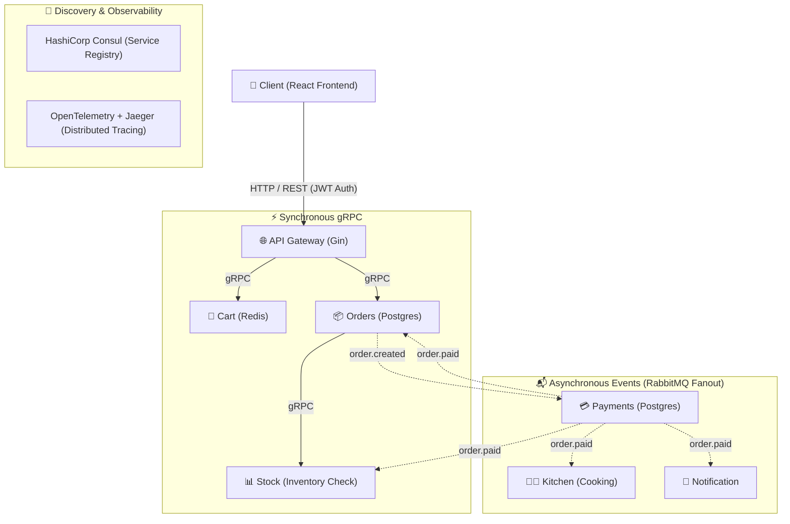

# OMS Go Microservices

> A production-inspired Order Management System built with Go, gRPC, RabbitMQ, Consul, OpenTelemetry, Gin, PostgreSQL, Redis, and React.

## Overview

This project demonstrates a robust, distributed backend built with independently deployable Go microservices, coupled with a modern React frontend. The system showcases best practices in distributed systems architecture, combining **synchronous gRPC** communication for real-time, critical-path interactions with **asynchronous RabbitMQ** events for decoupled, eventual consistency. 

Service discovery is dynamically managed by **HashiCorp Consul**, while **OpenTelemetry** and **Jaeger** provide comprehensive end-to-end distributed tracing across HTTP, gRPC, and AMQP boundaries.

---

## 🎯 Key Features

- **REST API Gateway**: Built with Gin, featuring JWT authentication (Access & Refresh tokens), rate limiting (Token Bucket), request routing, and acting as the single entry point for clients.
- **Microservices Architecture**: Domain-driven Go services communicating via gRPC and RabbitMQ.
- **Database-per-Service Pattern**: Isolated PostgreSQL databases for the `gateway`, `orders`, and `payments` services to ensure loose coupling.
- **Caching & Ephemeral State**: Redis-backed shopping carts for low-latency operations.
- **Service Discovery**: HashiCorp Consul integration for dynamic service registration, health checks, and client-side load balancing.
- **Observability**: OpenTelemetry tracing integrated with Jaeger for monitoring request lifecycles across HTTP, gRPC, and AMQP boundaries.
- **Resilient Message Broker**: RabbitMQ fanout exchanges with Dead Letter Exchanges (DLX), Dead Letter Queues (DLQ), and automated retry with backoff.
- **External Integration**: Razorpay payment gateway integration with HMAC-SHA256 signature verification and webhook idempotency.
- **Frontend App**: A React application built with Vite providing a user interface for the OMS.
- **Containerized Environment**: Complete local development setup using Docker & Docker Compose with multi-stage builds.

---

## 🏗️ Architecture & Communication Flow



### 🔄 Communication Model

| Pattern | Protocol | Scope | Purpose |
|---|---|---|---|
| **Synchronous** | **gRPC** (Protobuf) | `Gateway ➔ Cart, Orders ➔ Stock` | Low-latency, critical-path queries & inventory checks. |
| **Asynchronous** | **AMQP** (RabbitMQ) | `order.created`, `order.paid`, `user.registered` | Decoupled event broadcast with Dead-Letter Queues (DLQ). |
| **Edge Routing** | **HTTP/REST** (Gin) | `Client ➔ API Gateway` | Rate limiting (Token Bucket), JWT auth, and routing. |

---

### ⏱️ Order Lifecycle in 3 Phases

1. **Order Initiation (Sync gRPC)**:
   - Client sends checkout request to `Gateway`.
   - `Gateway` calls `Orders` via gRPC, which verifies inventory synchronously with `Stock`.
   - `Orders` saves record as `pending` in its PostgreSQL database and returns response to client.

2. **Payment Processing (Async Event)**:
   - `Orders` publishes `order.created` to RabbitMQ.
   - `Payments` service consumes event, calls Razorpay API, and generates a payment link.
   - Customer completes payment; Razorpay invokes `Payments` webhook.
   - `Payments` verifies HMAC-SHA256 signature, ensures idempotency, and publishes `order.paid`.

3. **Event Fanout & Fulfillment (Broadcast)**:
   - `Kitchen` starts preparation (advancing order status to `ready` via gRPC).
   - `Stock` permanently deducts reserved inventory.
   - `Orders` marks the order as `paid` in its database.
   - `Notification` sends receipt/confirmation.


---

## 📂 Project Structure (Domain Services)

| Service | Responsibility | Port (Dev) | Datastore |
| --- | --- | --- | --- |
| `gateway` | REST API, JWT authentication, rate limiting, and request routing. | `8080` | PostgreSQL (`gateway`) |
| `orders` | Creates orders, validates stock, and maintains order state (`OrderService`). | `2000` | PostgreSQL (`orders`) |
| `payments` | Creates payment links and processes Razorpay webhooks. | `2001` | PostgreSQL (`payments`) |
| `stock` | Provides inventory validation and final inventory updates (`StockService`). | `2002` | In-memory/Configured |
| `kitchen` | Consumes paid orders and marks preparation progress. | `2003` | None (Stateless) |
| `cart` | Provides Redis-backed shopping cart operations (`CartService`). | `2005` | Redis |
| `notification`| Consumes `user.registered` and `order.paid` events. | `2006` | None (Stateless) |
| `frontend` | React-based user interface for interacting with the OMS. | `5173` | N/A |
| `common` | Shared code (protobufs, telemetry, broker configs, error models, discovery). | N/A | N/A |

---

## 🚀 Getting Started

### Prerequisites

- **Docker & Docker Compose**: For infrastructure (Postgres, Redis, RabbitMQ, Consul, Jaeger).
- **Go 1.20+**: If running Go services directly on your host machine.
- **Make**: For using `Makefile` commands.
- **Node.js & npm**: For the React frontend.

### 1. Environment Configuration

Create a `.env` file in the root directory:

```env
# JWT Secret Key
JWT_SECRET_KEY=my-super-secret-key-1234

# Production/Standard Database Passwords
GATEWAY_POSTGRES_PASSWORD=password
ORDERS_POSTGRES_PASSWORD=password
PAYMENTS_POSTGRES_PASSWORD=password

# Development Database Passwords (Used by docker-compose.dev.yml)
DEV_GATEWAY_POSTGRES_PASSWORD=password
DEV_ORDERS_POSTGRES_PASSWORD=password
DEV_PAYMENTS_POSTGRES_PASSWORD=password

# Razorpay Credentials (Required for payments service)
RAZORPAY_KEY_ID=your_key_id
RAZORPAY_KEY_SECRET=your_key_secret
RAZORPAY_WEBHOOK_SECRET=your_webhook_secret
```

### 2. Running the System (Fully Dockerized)

The easiest way to start the entire system (infrastructure + all microservices) is using Docker Compose:

```bash
docker compose -f docker-compose.dev.yml up --build
```

This provisions:
- 3x PostgreSQL instances (Gateway, Orders, Payments)
- Redis & RabbitMQ (with management console)
- HashiCorp Consul & Jaeger
- All Go microservices

### 3. Running Services Locally (Hybrid Mode)

For faster iterative development, run the infrastructure in Docker and the Go services on your host:

Start infrastructure dependencies:
```bash
make deps
```

Start all Go services (configured for Windows CMD/terminals):
```bash
make run
```

### 4. Running the Frontend

```bash
cd frontend
npm install
npm run dev
```
The React application will be available at `http://localhost:5173`.

---

## 📡 API Endpoints (Gateway)

The API Gateway is exposed at `http://localhost:8080`.

### 🔑 Authentication (`UserService`)
- `POST /api/users/register` - Register a user (publishes `user.registered`). Returns JWT access & refresh tokens.
- `POST /api/users/login` - Authenticate a user. Returns JWT access & refresh tokens.
- `POST /api/users/refresh` - Refresh access token using a valid refresh token.

### 📦 Orders (`OrderService`) *(Protected by JWT)*
- `POST /api/customers/:customerID/orders` - Create an order (Body: `[{ "ID": "item_1", "Quantity": 2 }]`).
- `GET /api/customers/:customerID/orders` - Fetch all orders for a customer.
- `GET /api/customers/:customerID/orders/:orderID` - Fetch specific order details.
- `GET /api/customers/:customerID/orders/:orderID/status` - Fetch order status.

### 🛒 Cart & Inventory (`CartService` & `StockService`) *(Protected by JWT)*
- `GET /api/inventory` - List available items in stock.
- `GET /api/cart` - Fetch the active user's shopping cart.
- `POST /api/cart/items` - Add item to cart (Body: `{ "ProductID": "item_1", "Quantity": 1 }`).
- `DELETE /api/cart/items/:productID` - Remove a specific item from cart.
- `DELETE /api/cart` - Clear the user's cart.

### 💳 Payments Webhook
- `POST /webhook` (Payments service - port `2001`) - Razorpay payment confirmation webhook.

---

## 🔍 Observability & Tracing

The system uses **OpenTelemetry** to trace requests as they travel across HTTP, gRPC, and RabbitMQ boundaries.

When the system is running, access the **Jaeger UI** at:
👉 `http://localhost:16686`

This allows you to visualize request lifecycles, inspect latency bottlenecks, and understand the exact flow of an order from creation to payment and fulfillment.

---

## 🛠️ Technology Stack

| Component | Technology |
| --- | --- |
| **Backend Language** | Go (Golang) |
| **Frontend Framework** | React, Vite, JavaScript |
| **API Gateway** | Gin (HTTP Framework) |
| **RPC Framework** | gRPC & Protocol Buffers |
| **Message Broker** | RabbitMQ (AMQP) |
| **Service Registry**| HashiCorp Consul |
| **Databases** | PostgreSQL (Relational, Database-per-service) |
| **Cache** | Redis (In-memory cart) |
| **Distributed Tracing** | OpenTelemetry & Jaeger |
| **Deployment** | Docker & Docker Compose |

---

## License

Educational project for learning distributed systems, event-driven architectures, and Go microservices.
