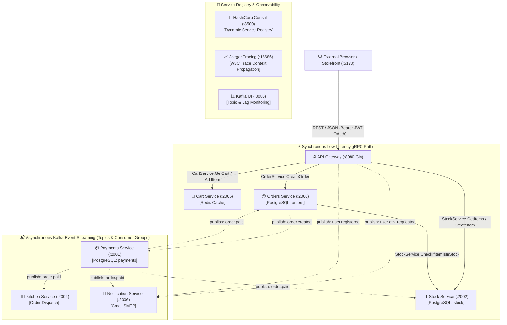

# ⚡ STRATUM — High-Performance Distributed Order Management System

[](https://golang.org)
[](https://react.dev)
[](https://www.typescriptlang.org)
[](https://grpc.io)
[](https://kafka.apache.org)
[](https://www.postgresql.org)
[](https://redis.io)
[](https://www.consul.io)
[](https://opentelemetry.io)
[](https://www.docker.com)

A production-grade, event-driven Order Management & Commerce System engineered in **Go** and **React 19**. **STRATUM** showcases modern distributed systems architecture: **Database-per-Service**, dual-protocol communication (**synchronous gRPC** for low-latency reservations and **asynchronous Apache Kafka topics** for resilient decoupled transactions), dynamic service discovery via **HashiCorp Consul**, full-stack **Google OAuth 2.0**, automated **Gmail SMTP notifications**, end-to-end distributed tracing via **OpenTelemetry & Jaeger**, and granular **Role-Based Access Control (RBAC)**.

---

## 📑 Table of Contents

1. [Project Overview & Purpose](#-project-overview--purpose)
2. [Key Features](#-key-features)
3. [Technology Stack](#-technology-stack)
4. [Distributed System Architecture](#-distributed-system-architecture)
5. [Folder Structure](#-folder-structure)
6. [Configuration & Environment Variables](#-configuration--environment-variables)
7. [Database Setup & Schemas](#-database-setup--schemas)
8. [Setup & Installation](#-setup--installation)
9. [Running the Project](#-running-the-project)
   - [Development Mode (Hybrid)](#option-a-development-mode-hybrid)
   - [Production Mode (Docker Compose)](#option-b-production-mode-docker-compose)
10. [API Specification (REST & gRPC)](#-api-specification-rest--grpc)
11. [AI Agents & Developer Pair Programming](#-ai-agents--developer-pair-programming)
12. [Usage Workflows](#-usage-workflows)
13. [Contributing Guidelines](#-contributing-guidelines)
14. [Future Roadmap](#-future-roadmap)
15. [License](#-license)

---

## 🎯 Project Overview & Purpose

**STRATUM** solves the challenges inherent in distributed e-commerce transactions: race conditions during inventory checkout, partial failure states during payment processing, service outages, and cross-service observability.

Traditional monoliths rely on heavy database transactions with `SERIALIZABLE` isolation locks that degrade under high concurrency. **STRATUM** decomposes the order lifecycle into independent, domain-driven microservices that collaborate via:
* **Synchronous gRPC (HTTP/2 binary protobufs)** for sub-millisecond stock checks and server-side shopping cart mutations.
* **Asynchronous Apache Kafka Topics** for resilient order creation, payment handoff, kitchen dispatch, stock depletion, and email notifications.
* **Distributed Sagas & Dead-Letter Queues (DLQ)** to guarantee eventual consistency and auditability without blocking client threads.

---

## ✨ Key Features

* **⚡ Dual-Protocol Communication**: High-throughput gRPC for latency-critical paths; Apache Kafka (KRaft mode) for non-blocking event-driven transaction pipelines.
* **🛡️ Dual-Mode Google OAuth 2.0 & JWT RBAC**: Instant 1-click **Developer Sandbox** for zero-setup local testing; seamless switch to official **Google Cloud OAuth** via `.env`. Automatic role assignment for administrators (`admin@stratum.com`).
* **📧 Automated Email Notifications (Gmail SMTP)**: Dispatches real 6-digit registration verification OTPs and welcome emails via TLS-authenticated Gmail SMTP with graceful terminal logging fallbacks.
* **📦 Database-per-Service Isolation**: Each service strictly owns its storage (4 dedicated PostgreSQL instances + Redis cache). Zero direct cross-database queries.
* **🧭 Dynamic Service Discovery & Health Checking**: Automatic registration with HashiCorp Consul with 1-second TTL heartbeats and client-side round-robin load balancing.
* **📊 End-to-End Distributed Tracing**: OpenTelemetry instrumentation across HTTP endpoints, gRPC calls, and Kafka event headers, visualized in Jaeger.
* **🛒 Synchronous Server-Owned Redis Cart**: Ephemeral basket storage with Redis TTL, eliminating stale cart drift between browser sessions.
* **🎨 Modern React 19 Frontend**: High-performance storefront and dedicated enterprise Admin Console built with Vite, TypeScript, Tailwind CSS, TanStack Query, and Zustand.

---

## 🛠️ Technology Stack

| Layer | Technologies |
| :--- | :--- |
| **Backend Services** | Go 1.20+, Gin Web Framework, gRPC Go, Protocol Buffers v3 |
| **Event Streaming** | Apache Kafka (KRaft mode, `segmentio/kafka-go`), Kafka UI |
| **Service Discovery** | HashiCorp Consul (Raft consensus, 1s TTL health checks) |
| **Databases & Cache** | PostgreSQL 15 (GORM ORM), Redis 7 (Alpine) |
| **Observability** | OpenTelemetry SDK, OTLP Trace Exporter, Jaeger Tracing |
| **Frontend Web App** | React 19, TypeScript 5.9, Vite 8, Tailwind CSS, Lucide Icons |
| **Frontend State & Data**| TanStack Query v5, Zustand, React Hook Form, Zod |
| **Authentication** | Google OAuth 2.0, JWT (HS256 tokens), bcrypt password hashing |
| **Containerization** | Docker, Docker Compose v2 |

---

## 🏛️ Distributed System Architecture



---

## 📂 Folder Structure

```
oms-go-microservices/
├── cart/                      # Ephemeral shopping cart service (gRPC + Redis)
├── common/                    # Shared library across all Go microservices
│   ├── api/                   # Compiled Protobuf contracts (oms.pb.go, oms_grpc.pb.go, oms.proto)
│   ├── auth/                  # JWT token creation and validation utilities
│   ├── broker/                # Apache Kafka producer, consumer groups, and event payloads
│   └── discovery/             # Consul dynamic registration and gRPC client resolvers
├── frontend/                  # React 19 + TypeScript + Vite storefront & operations dashboard
│   ├── src/app/               # Application shell, routing, and provider bindings
│   ├── src/components/ui/     # Design system primitives (Button, Input, Card, Dialog, Badge)
│   ├── src/config/            # Centralized branding, photography, and metadata (site.ts)
│   ├── src/features/          # Domain hooks (auth, cart, catalog, orders, admin)
│   ├── src/layouts/           # StorefrontLayout (customer) & AdminLayout (RBAC restricted)
│   └── src/pages/             # Customer storefront and Admin management pages
├── gateway/                   # Edge API Gateway (Gin REST router, Auth, OAuth, Rate Limiting)
├── kitchen/                   # Kitchen fulfillment service (Kafka consumer for order.paid)
├── notification/              # Notification service (Kafka consumer, Gmail SMTP & OTP dispatcher)
├── orders/                    # Order orchestration service (gRPC server, Kafka producer/consumer)
├── payments/                  # Payment processing service (Razorpay SDK, Webhooks, In-memory mock)
├── scripts/                   # Developer lifecycle automation scripts (PowerShell)
├── stock/                     # Inventory service (gRPC server, row-level locking, GORM models)
├── docker-compose.yml         # Containerized production stack specification
├── docker-compose.dev.yml     # Infrastructure-only stack (Kafka, Consul, Redis, Postgres, Jaeger)
├── go.work                    # Multi-module Go workspace definition
└── .env                       # Central environment variables configuration
```

---

## ⚙️ Configuration & Environment Variables

All services load configuration from the root [`.env`](file:///c:/oms-go-microservices/.env) file:

```env
# ==============================================================================
# Database Passwords (Container & Local)
# ==============================================================================
GATEWAY_POSTGRES_PASSWORD=password
ORDERS_POSTGRES_PASSWORD=password
PAYMENTS_POSTGRES_PASSWORD=password
STOCK_POSTGRES_PASSWORD=password
DEV_GATEWAY_POSTGRES_PASSWORD=password
DEV_ORDERS_POSTGRES_PASSWORD=password
DEV_PAYMENTS_POSTGRES_PASSWORD=password
DEV_STOCK_POSTGRES_PASSWORD=password

# ==============================================================================
# Security & Payment Gateway
# ==============================================================================
JWT_SECRET_KEY=my-super-secret-key-1234
RAZORPAY_KEY_ID=rzp_test_TaRB7WSJLruWhc
RAZORPAY_KEY_SECRET=rasU6MRl5wfS053nkO1zCLQ3
RAZORPAY_WEBHOOK_SECRET=#jaydeep123

# ==============================================================================
# Infrastructure Networking
# ==============================================================================
KAFKA_BROKERS=localhost:9092
CONSUL_ADDR=localhost:8500
REDIS_ADDR=localhost:6379
JAEGER_ADDR=localhost:4318
GATEWAY_HTTP_ADDRESS=http://localhost:8080
FRONTEND_URL=http://localhost:5173

# ==============================================================================
# Google OAuth 2.0 (Leave empty for interactive Dev Sandbox mode)
# ==============================================================================
GOOGLE_CLIENT_ID=your-google-client-id.apps.googleusercontent.com
GOOGLE_CLIENT_SECRET=GOCSPX-your-google-client-secret
GOOGLE_REDIRECT_URL=http://localhost:8080/api/auth/google/callback

# ==============================================================================
# Admin & Email Dispatch (Gmail SMTP)
# ==============================================================================
ADMIN_EMAIL=admin@stratum.com
SMTP_HOST=smtp.gmail.com
SMTP_PORT=587
SMTP_EMAIL=your-gmail-account@gmail.com
SMTP_PASSWORD=your-16-char-app-password
SMTP_SENDER_NAME=STRATUM
```

---

## 🗄️ Database Setup & Schemas

STRATUM adheres to the **Database-per-Service** pattern with independent schemas:

| Service | Engine | Port | Database Name | Primary Entities |
| :--- | :--- | :--- | :--- | :--- |
| **`gateway`** | PostgreSQL 15 | `5435` | `gateway` | `users` (id, email, password_hash, role, provider, provider_id, avatar_url) |
| **`orders`** | PostgreSQL 15 | `5433` | `orders` | `orders` (id, customer_id, status, payment_link), `order_items` (order_id, item_id, quantity, price_id) |
| **`payments`** | PostgreSQL 15 | `5434` | `payments` | `payments` (id, order_id, customer_id, amount, status, razorpay_order_id, razorpay_payment_id) |
| **`stock`** | PostgreSQL 15 | `5436` | `stock` | `items` (id, name, price, quantity) with row-level transaction safety |
| **`cart`** | Redis Cache | `6379` | DB 0 | `cart:<customer_id>` (JSON hash map of product IDs, quantities, and TTL expiry) |

> **Automated Migrations**: Every service automatically verifies and migrates its tables using GORM `AutoMigrate` upon startup. No manual SQL scripts required.

---

## 🚀 Setup & Installation

### 1. Prerequisites
* **[Go](https://golang.org/)** v1.20+ (tested on v1.24/v1.26)
* **[Docker Desktop](https://www.docker.com/)** with Docker Compose v2+
* **[Node.js](https://nodejs.org/)** v18+ and **npm** v9+
* **[Git](https://git-scm.com/)**

### 2. Clone and Initialize Workspace
```bash
git clone https://github.com/jaydeepjr28/Order-Management-service---go-Microservices.git stratum
cd stratum

# Synchronize Go multi-module workspace
go work sync

# Install frontend dependencies
cd frontend
npm install
cd ..
```

---

## 🏃 Running the Project

### Option A: Development Mode (Hybrid)
Recommended for development. Docker hosts infrastructure; microservices and frontend run natively with rapid reload:

1. **Start Infrastructure Containers**:
   ```bash
   docker compose -f docker-compose.dev.yml up -d
   ```
   *(Spins up Kafka, Kafka UI, Consul, Redis, Jaeger, and the 4 Postgres instances).*

2. **Start Microservices**:
   Run each service in separate terminal tabs (or use the provided scripts):
   ```bash
   cd stock && go run .
   cd orders && go run .
   cd payments && go run .
   cd kitchen && go run .
   cd cart && go run .
   cd notification && go run .
   cd gateway && go run .
   ```

3. **Start Frontend Dev Server**:
   ```bash
   cd frontend
   npm run dev
   ```
   *Frontend is live at **`http://localhost:5173`**; API Gateway at **`http://localhost:8080`**.*

---

### Option B: Production Mode (Docker Compose)
To launch the entire containerized fleet (services + infrastructure + frontend):
```bash
docker compose up --build -d
```
Scale individual microservices with one command:
```bash
docker compose up --scale orders=2 --scale stock=2 -d
```

---

## 📡 API Specification (REST & gRPC)

### API Gateway REST Endpoints (`:8080`)

#### Authentication & Accounts
* `POST /api/users/register/send-otp`: Request a 6-digit registration code via Kafka.
* `POST /api/users/register/verify-otp`: Validate code, create user account, and issue tokens.
* `POST /api/users/login`: Authenticate via email & password.
* `POST /api/users/refresh`: Refresh expired JWT access token using refresh token.
* `GET  /api/auth/google/login`: Initiate Google OAuth 2.0 flow (or Dev Sandbox).
* `GET  /api/auth/google/callback`: Handle OAuth callback, auto-provision user, issue tokens.

#### Shopping Cart
* `GET    /api/cart`: Retrieve current user's server-synchronized Redis cart.
* `POST   /api/cart/items`: Add or increment item quantity (`{ "id": "1", "quantity": 2 }`).
* `DELETE /api/cart/items/:productID`: Remove item from cart.
* `DELETE /api/cart`: Clear cart session.

#### Order Management
* `POST /api/customers/:customerID/orders`: Create new order (verifies stock via gRPC, emits `order.created` to Kafka).
* `GET  /api/customers/:customerID/orders`: List all orders for customer.
* `GET  /api/customers/:customerID/orders/:orderID`: Retrieve specific order and payment URL.
* `POST /api/customers/:customerID/orders/:orderID/cancel`: Cancel order and trigger Saga rollback.

#### Operations & Admin Console (RBAC: `admin` role required)
* `GET  /api/admin/orders`: Inspect all system-wide orders across customer accounts.
* `POST /api/admin/orders/:orderID/cancel`: Force administrative order cancellation.
* `POST /api/admin/inventory`: Add a new SKU to the stock catalog.
* `PUT  /api/admin/inventory/:id`: Adjust live inventory quantities and unit pricing.
* `GET  /api/admin/analytics`: Aggregate real-time stock valuation and microservice health.

---

### gRPC Internal Contracts (`common/api/oms.proto`)

```protobuf
syntax = "proto3";
package api;

service OrderService {
  rpc CreateOrder(CreateOrderRequest) returns (Order);
  rpc GetOrder(GetOrderRequest) returns (Order);
  rpc UpdateOrder(Order) returns (Order);
}

service StockService {
  rpc CheckIfItemIsInStock(CheckIfItemsInStockRequest) returns (StockCheckResponse);
  rpc GetItems(GetItemsRequest) returns (GetItemsResponse);
  rpc CreateItem(CreateItemRequest) returns (Item);
  rpc UpdateItem(UpdateItemRequest) returns (Item);
}

service CartService {
  rpc GetCart(GetCartRequest) returns (Cart);
  rpc AddItem(AddItemRequest) returns (Cart);
  rpc RemoveItem(RemoveItemRequest) returns (Cart);
  rpc ClearCart(ClearCartRequest) returns (Empty);
}
```

---

## 🤖 AI Agents & Developer Pair Programming

STRATUM was engineered with automated developer ergonomics and agentic workflows in mind:
* **Pre-Integrated IDE Context**: Contains structured knowledge items and schemas enabling AI assistants (like Google DeepMind Antigravity, GitHub Copilot, and Cursor) to accurately trace gRPC stubs, Kafka topics, and typed frontend contracts.
* **Deterministic Dual-Mode Testing**: When third-party credentials (like Google OAuth or Razorpay keys) are absent, services dynamically activate interactive sandboxes so agents and automated tests can run without blocking on manual external logins.
* **Resilient Graceful Degradation**: Eliminates hard `log.Fatalf` crashes during downstream service restarts, enabling continuous background integration without cascade failures.

---

## 🔄 Usage Workflows

### 1. Customer Shopping & Asynchronous Fulfillment
1. **Browse**: User browses artisanal products on `http://localhost:5173/products`. Catalog is fetched live from the `stock` service via Gateway.
2. **Basket**: User adds items to cart. Requests synchronize immediately with the Redis `cart` service.
3. **Checkout**: User clicks "Place Order".
   - Gateway calls `OrderService.CreateOrder` via gRPC.
   - `orders` service executes a synchronous gRPC stock reservation check against `stock`.
   - Order is inserted as `status: "pending"` and emits `order.created` to Kafka.
4. **Payment Handoff**: `payments` service consumes `order.created`, generates a payment link, and saves it. The frontend polls and displays the payment action button.
5. **Fulfillment**: Once marked paid, `payments` emits `order.paid`. `kitchen` starts preparation, `stock` permanently deducts physical inventory, and `notification` sends a confirmation email.

### 2. Admin Operations & Inventory Audit
1. Sign in using `admin@stratum.com` (via Google OAuth or standard login).
2. Gateway verifies the email matches `ADMIN_EMAIL` and embeds `role: "admin"` in the JWT.
3. The frontend unlocks the **Admin Console** at `/admin`.
4. The administrator can adjust SKU quantities in real time, view company inventory valuation, audit active customer orders, or cancel stalled transactions.

---

## 👥 Contributing Guidelines

1. **Fork the Repository** and create a feature branch (`git checkout -b feat/new-capability`).
2. **Ensure Compilation**:
   - Go modules: `go build ./...` must succeed across all modules with zero errors.
   - Frontend: `npm run build` must complete with zero TypeScript warnings.
3. **Preserve Documentation Integrity**: Update contracts in `common/api/oms.proto` and recompile stubs using `protoc` if payload definitions change.
4. **Follow Semantic Commits**: `feat:`, `fix:`, `refactor:`, `docs:`, `test:`.
5. **Open a Pull Request** against `main`.

---

## 🗺️ Future Roadmap

- [ ] **Kubernetes Manifests & Helm Charts**: Declarative deployment manifests for GCP GKE and AWS EKS.
- [ ] **Real-Time WebSocket Gateway**: Replace client order status polling with real-time bidirectional WebSocket events.
- [ ] **Elasticsearch Catalog Search**: Full-text fuzzy search with faceted category filtering across tens of thousands of SKUs.
- [ ] **Temporal / Cadence Workflow Engine**: Migrate complex long-running Saga rollbacks to stateful orchestrators.

---

## 📄 License

This codebase is open-source under the [MIT License](LICENSE). Built for learning and engineering production-grade distributed microservices, event-driven architectures, and Go systems programming.
